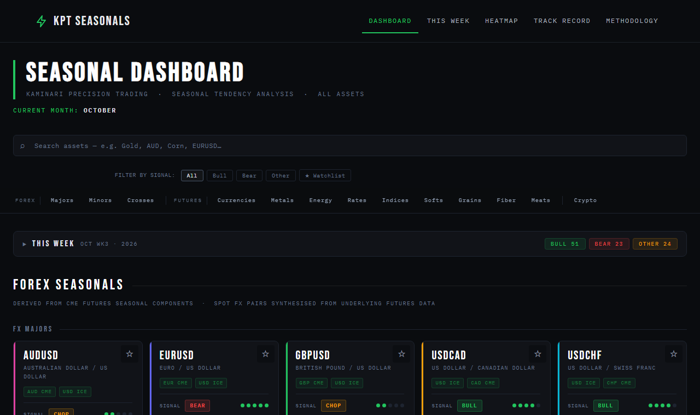

# KPT Seasonals

**A free seasonal-tendency dashboard for 98 futures, forex and crypto markets.**
Decades of seasonal data turned into a clear weekly bias (Bullish, Bearish or Choppy), with
market profiling, macro context and AI synthesis layered on top.

**Live site:** <https://kpt-seasonals.netlify.app/>



## What it does

- **Weekly signals** for every market, with a 1–5 conviction score. They come from Moore Research
  Center seasonal charts (futures), are derived from them (forex pairs), or are computed from price
  history (crypto).
- **A seven-tab dashboard per asset**: Seasonals, Trend curve, Market Profiling, Live Price, Macro
  calendar, Upload (backtest your own MT5 data) and AI Analysis (Claude, ChatGPT, Gemini or a local
  Ollama model, using your own key).
- **Site-wide views**: [This Week](https://kpt-seasonals.netlify.app/this-week) digest with a
  watchlist, a 12-month [Heatmap](https://kpt-seasonals.netlify.app/heatmap), and a
  [Track Record](https://kpt-seasonals.netlify.app/track-record) that grades past signals against price.
- **Market Profiling** for 14 instruments, built from full MT5 M1 history: profile shapes, range
  distributions, timing of highs and lows, and a TimesFM range forecast.

There are no accounts, no cookies of its own and no analytics. AI keys stay in your browser.

## Repository layout

| Folder | What's in it |
| --- | --- |
| [`frontend/`](frontend/) | The static site. This is the only folder Netlify publishes. |
| [`backend/`](backend/) | Python data pipeline: cleans MT5 exports and computes profiling stats, derived seasonals, range forecasts and the track record. |
| [`scripts/`](scripts/) | Node scripts that sync pipeline output into `frontend/data/`, generate indexes and run the local server. |
| [`docs/`](docs/) | Project documentation, specs and mockups. |

## Run it locally

```bash
node scripts/serve_local.js        # → http://localhost:8888/
```

This server applies `netlify.toml`'s routes and headers, so clean URLs such as `/dashboard` work.
Plain static servers (VS Code Live Server, `python -m http.server`) don't apply them.

The pipeline (only needed to refresh data) is described in [backend/README.md](backend/README.md).

## Documentation

| Doc | For |
| --- | --- |
| [User Guide](docs/USER_GUIDE.md) | Using the site, every tab, and the step-by-step trade-idea workflow |
| [Assets](docs/ASSETS.md) | All 98 markets and the key seasonal finding for each |
| [Architecture](docs/ARCHITECTURE.md) | How the code fits together: routes, modules, data flow, security |
| [Contributing](docs/CONTRIBUTING.md) | Adding assets, refreshing data, maintenance checklists |
| [Data Dictionary](docs/DATA_DICTIONARY.md) | Data file schemas, signal vocabulary, storage keys |
| [Changelog](docs/CHANGELOG.md) | Version history |
| [All docs →](docs/README.md) | Full index, including roadmaps and the prompt library |

## Disclaimer & attribution

For education and research only. This is not financial advice; see the
[Risk Disclosure](https://kpt-seasonals.netlify.app/risk). Seasonal tendency data is
© Moore Research Center. Dashboard design and analysis framework © 2026 Kaminari Precision Trading.
